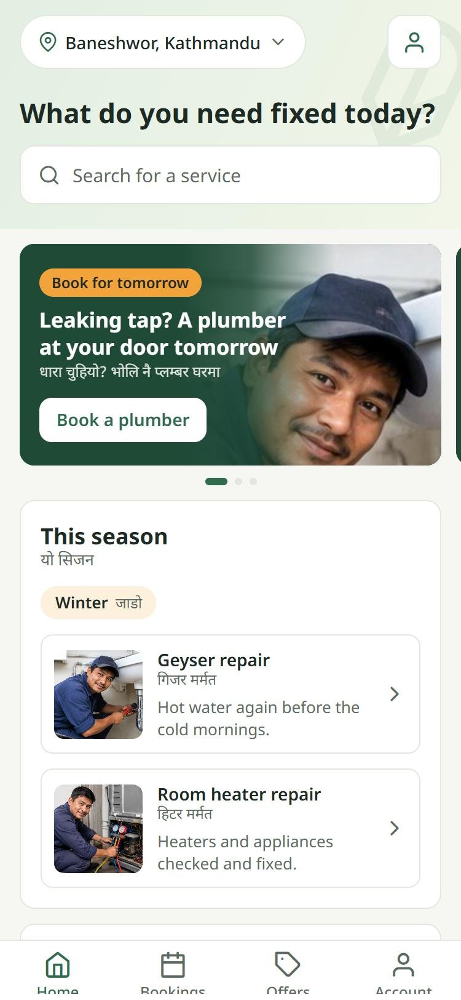
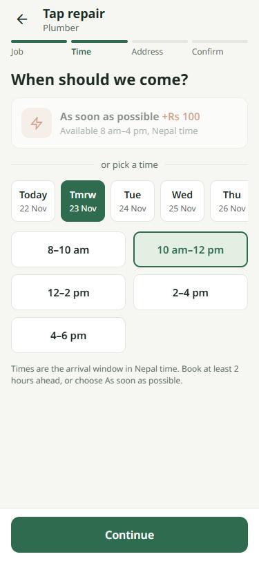
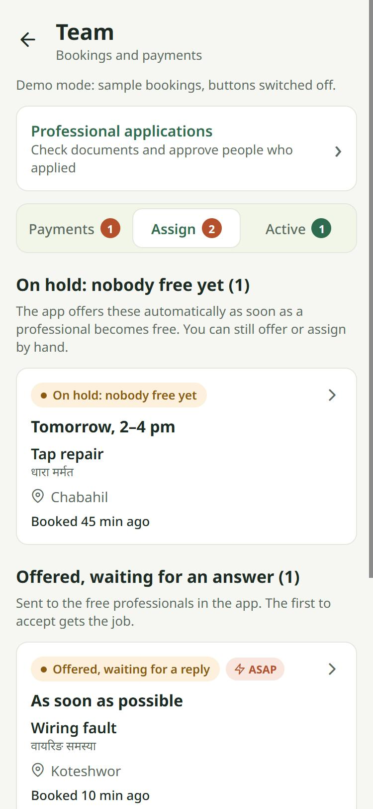
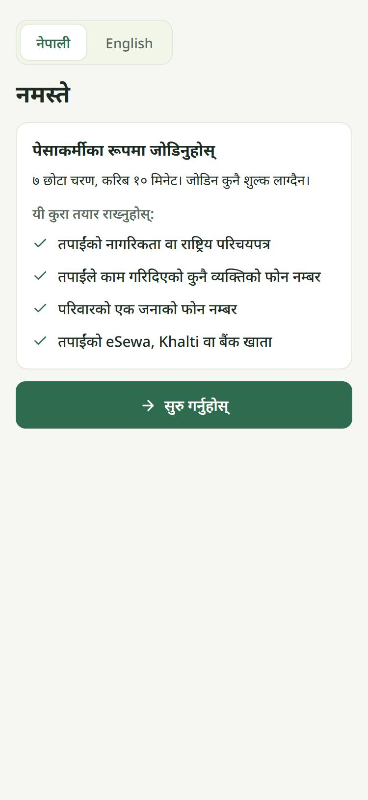
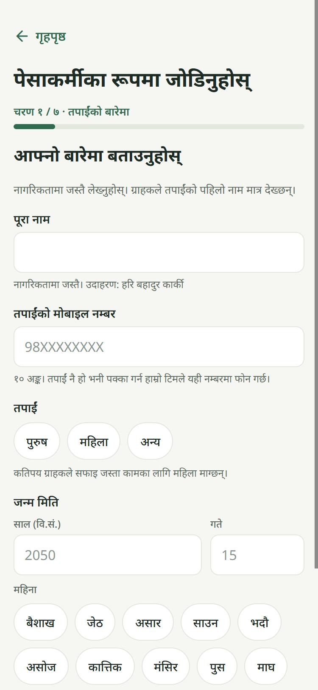

# Handyman Nepal

**Book a trusted plumber, electrician, cleaner or painter in Kathmandu, and know exactly who is coming.**

A home-services platform built for Nepal. Customers book a verified professional
for a fixed time and pay a small advance with eSewa, Khalti, IME Pay or a bank.
An operations team checks the payments and dispatches the jobs, and professionals
take work through their own app, in Nepali or English.

> **Status:** in active development and being tested on real phones. Not launched yet.

<p align="center">
  
  
  
  
  
</p>

---

## Why it exists

Finding a reliable tradesperson in Nepal still mostly happens by word of mouth.
Customers don't know who will come, when they will arrive or what it will cost.
Good tradespeople struggle to find steady work. This app tries to fix both sides:

- **Trust:** every professional is checked (ID, face photo, a work reference and
  a phone call) before they get a single job.
- **Clarity:** fixed time windows, prices up front, a start code at the door, and
  any extra parts approved by the customer before they are charged.
- **Made for Nepal:** Nepali first, Bikram Sambat dates, all 77 districts, Nepali
  keyboard digits accepted everywhere, local wallets, and landmarks instead of
  street addresses.

## What it does

### 1. Customer app
- Browse and search services, and see seasonal offers, without signing in.
- Book in four short steps: **job → time → address → confirm**.
  - Two-hour arrival windows, or *as soon as possible* during working hours.
  - Full slots are greyed out.
- Addresses use a **landmark** and a **pin on the map**, so the professional can find the house.
- A **mobile number** is required for every job, and is saved to the account for next time.
- Pay a small **advance** by eSewa, Khalti, IME Pay or bank, then enter the transaction ID.
- Track the job: *Booked → Assigned → On the way → Started → Done*, with the professional's name and a call button.
- A private **start code** is given to the professional on arrival.
- **Extra parts** are approved or declined in the app.
- Receipt and star rating at the end.
- Sign in with a phone code, an email code or Google.

### 2. Team tools (inside the customer app, for staff only)
- **Payments:** check each transaction ID against the wallet or bank statement, then confirm or reject it.
- **Automatic dispatch:** once an advance is confirmed, the job goes to every free professional who matches.
  - Matching looks at the service, the area and the time. The first to accept gets the job.
  - If nobody is free, the booking goes **on hold**.
  - It is re-offered automatically when someone becomes free: they turn availability on, a job is cancelled, they are approved, or they add a service.
- **Urgent list:** bookings still on hold 2 hours before their time.
- Offer or assign by hand, with call and SMS buttons, for professionals who don't use the app.
- **Professional applications:** documents, details and a checklist, then **approve**, **reject with a reason**, or **suspend**.

### 3. Handyman Pro, the professional app
- A separate app built from the same code. **Nepali by default**, with a one-tap switch to English.
- A **7-step application**, one topic per screen, with choices instead of typing wherever possible:
  1. About you
  2. Where you live
  3. Work and skills (CTEVT/NSTB level)
  4. ID
  5. Emergency contact and work reference
  6. Payout (eSewa, Khalti or bank)
  7. Check and agree
- ID and face photos go to **private storage** that only the team can open.
- A home screen shows progress at each stage: not started, photos missing, being checked, needs a fix, approved.
- **Job offers** show the job, area and time. The full address and the customer's phone appear only after accepting.
- **Job flow:** *on my way* → start code → add extra parts → mark done and collect the bill.
- **Earnings:** billed amount, commission and payouts.

## Built with

| Part | Technology |
| --- | --- |
| Mobile apps | [Expo](https://expo.dev) SDK 58, React Native, Expo Router. One codebase, two app variants. |
| Backend | [Supabase](https://supabase.com): Postgres, Auth, Storage |
| Security | Row-level security on every table. All business rules live in database functions that check who is calling and return messages a person can understand. |
| Tests | Database tests run on a local in-memory Postgres ([PGlite](https://pglite.dev)) |
| Languages | English and Nepali (`src/data/proStrings.js`) |

## Project layout

```
src/
  app/            Screens (Expo Router). (tabs) = customer, (pro) = professional,
                  team/ = staff tools, book/ pay/ jobs/ apply.js = flows
  components/     Shared UI: booking steps, job cards, application form …
  lib/            Sign-in, bookings, dispatch, language, storage
  data/           Service catalogue, Nepal districts, Nepali/English text
supabase/
  migrations/     Database changes, run in date order
  checks/         Read-only SQL for support questions
tests/            Database tests (npm test)
docs/             Test checklist and screenshots
```

## Running it

```bash
npm install
cp .env.example .env.local          # add your Supabase URL and publishable key
npx expo start                      # customer app (scan the QR code with Expo Go)
npm run pro                         # professional app, on port 8082
npm run web:demo                    # customer app in a browser with sample data, no backend
npm run pro:demo                    # professional app in a browser with sample data
npm test                            # database tests
```

To set up the database, follow [supabase/README.md](supabase/README.md): run the
migrations in date order in the Supabase SQL Editor.

## Roadmap

- Automatic payment checks with eSewa and Khalti merchant accounts
- Push notifications and SMS (Sparrow) for job offers
- A selfie check against the ID photo when someone applies
- Reschedule and cancellation fees in the app
- A web dashboard for the operations team

## License

Copyright © 2026 Sonish Khanal. **All rights reserved.** The code is public so
people can see the work, but it is not open source. See [LICENSE](LICENSE).

Most service photos were provided for the app. Two cleaning illustrations are
AI-generated (see [assets/photos/README.md](assets/photos/README.md)).
